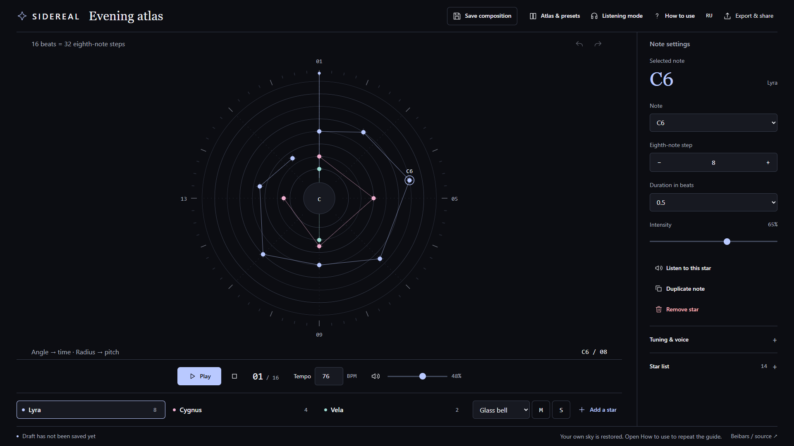
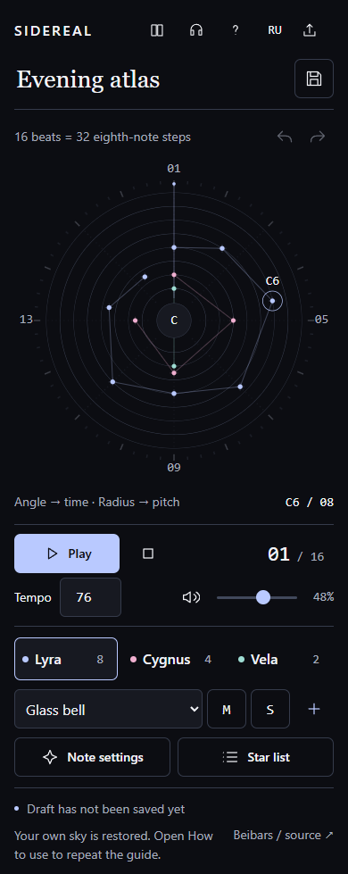
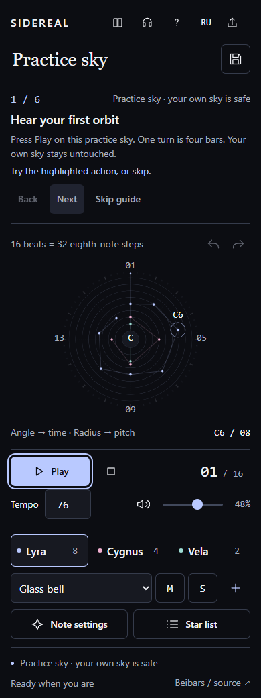

# SIDEREAL

**Draw a constellation. Hear an orbit.**

A free musical observatory by **Beibars / [seoshiro](https://github.com/seoshiro)**. Place notes in a circular sky and hear a four-bar composition played by a clockwise orbital cursor. A working musical instrument and creative toy, built with SVG and Web Audio.

**[Open SIDEREAL](https://seoshiro.github.io/sidereal/)** · [Verification](docs/QA.md) · [MIT license](LICENSE)



## Play and compose

First entry opens an interactive six-step guide in its own practice sky. Play the example, choose a constellation, add a star, move it, change its duration or intensity, then save it to the practice atlas. Back, Next and Skip are available; the guide resumes after reload. **How to use** repeats it. Practice never writes your draft or personal atlas, and it preserves an incoming shared score.

Outside the guide, open **Atlas & presets** for three deterministic starting compositions or an empty sky. Select **Lyra**, **Cygnus** or **Vela**; each has an independent synthesized voice and mute/solo controls. Click the orbit to add a note, drag to move it, or use the exact note controls and Star list. Angle is time; radius is pitch.

An orbit has **16 beats = 32 eighth-note steps**. There are 15 scale degrees per voice, three constellations and up to 96 stars. Choose pentatonic, natural minor, Dorian or major tuning; root C–B; tempo 40–180 BPM; durations 0.25, 0.5, 1, 2 or 4 beats. Glass bell, Felt keys and Low tide differ in register and envelope. Duplicate copies a selected note to the next step. Listening mode enlarges the orbit and returns to the same editor selection and disclosure state.

Sound starts only after **Play** or **Listen to this star**. Pause preserves position; Stop resets the orbit and clears voices. Master mute and volume remain beside the transport. Changing a preset stops playback. A hidden page pauses and requires an explicit restart.

## Save, transfer and export

- The edited draft restores on this device. Its status explicitly distinguishes saved, unsaved and failed writes. **Save composition** stores a named entry in a separate local atlas, up to 24 compositions; saving the same composition updates it.
- **Score file · JSON** exports the portable SIDEREAL v1 format. Import validates version, types, bounds, unique safe IDs and maximum 96 notes. Files over 60 KB are rejected. Unknown fields are stripped.
- **Share links** carry validated score data in the URL fragment, limited to 12,000 encoded characters. The score is not uploaded by the app. Anyone with the link can read it. Large scores should travel as JSON. The fragment stays intact until you actually edit or save the incoming score, including while practising the guide.
- **PNG** exports a real 1600 × 1880 constellation score with title, tempo, tuning and voices, using the same graphite and constellation palette as the editor.
- **WAV** uses `OfflineAudioContext` to render one orbit and release tails into stereo 44.1 kHz, 16-bit PCM. It respects layer mute/solo and master volume. Master mute affects listening and does not silently blank the file.

Local browser storage is not a backup. Clearing site data removes saved compositions. Export JSON for work you want to keep.

## Keyboard, touch and motion

- **Space** plays/pauses outside form controls; **Escape** stops sound and closes the mobile note sheet or export menu.
- Focus a star: **Left/Right** changes time, **Up/Down** changes pitch, **Enter** opens exact parameters, **Delete/Backspace** removes it.
- **Ctrl/Cmd + Z** undoes; **Ctrl/Cmd + Shift + Z** redoes. History holds 60 edits and resets on reload. Play and Undo retain focus across UI updates.
- **Alt + Left/Right** navigates the guide. Native button and form keyboard controls also work throughout.
- On phones, orbit and transport come first; compact layers follow. Note settings and the Star list open an internally scrolling sheet with contained focus. Close restores focus to its opener. Close stars offer a chooser; the list is an alternative to dragging. Empty orbit space permits normal vertical touch scrolling.
- Native controls, accessible names, visible focus, live status and one RU/EN translation table are used. M/S explanations appear on hover and keyboard focus. Normal control text is 14–16 px. Secondary text on the surface has a measured 7.81:1 contrast ratio.
- Reduced motion removes the sweep, pulses and loader assembly animation while preserving audio and the beat counter. Stop cancels the visual loop; the counter changes only when the displayed beat changes.

 

## Run and verify

Use Node.js 22.12+ or 24 with npm. Production is static and has no runtime package dependencies.

```sh
npm ci --ignore-scripts
npm run dev
npm test
npm run build
```

Browser QA uses an owned, temporary Chromium profile:

```sh
npx playwright install chromium
# Keep npm run dev running in another terminal.
npm run qa
node scripts/interaction-v2.mjs
node scripts/capture-v2.mjs
```

Set `QA_BROWSER` to an existing Chromium executable and `QA_URL` to the published site when needed. Reports/downloads go to ignored `qa-artifacts/`; real screenshots go to `docs/screenshots/`. The browser tests include an actual 70-second playback check. They do not establish human listening quality.

## Architecture

| File                              | Responsibility                                                                                  |
| --------------------------------- | ----------------------------------------------------------------------------------------------- |
| `src/boot.ts`, `index.html`       | Real module preparation, quiet reduced-motion loading, error/retry fallback                     |
| `src/model.ts`                    | Unchanged v1 music model, deterministic presets, geometry, validation, share codec              |
| `src/audio.ts`                    | Unchanged finite Web Audio voices, bounded scheduler, amplitude budget, compressor, offline WAV |
| `src/ui.ts`, `src/main.ts`        | One static shell, keyed SVG/list updates, transport, editing, history, atlas and exports        |
| `src/lesson.ts`, `src/storage.ts` | Validated separate practice record and honest storage result handling                           |
| `src/palette.ts`, `src/style.css` | Shared design tokens, responsive layouts, focus and motion rules                                |
| `src/i18n.ts`                     | One keyed RU/EN translation table                                                               |
| `tests/`, `scripts/`              | Model/storage tests and browser/interaction/capture verification                                |

The audio scheduler runs every 25 ms with a 100 ms horizon. Oscillators have finite stop times and disconnect on completion. Pause, Stop and musical edits clear outstanding voices. An amplitude budget accounts for overlapping tails and reserves a preview voice; compression and WAV peak limiting protect the output. Visual animation reads the audio clock and does not schedule sound.

No samples, commercial recordings, remote fonts, analytics, paid APIs, keys, account registration or billing. GitHub Pages serves the build for free. Vite's relative asset base supports `/sidereal/`. GitHub Actions runs model/storage tests, strict type checking and the production build before Pages deployment.

## Honest limits

This is a fixed four-bar, three-voice instrument, without MIDI import, microphone recording or device synchronization. PNG is a constellation score, not staff notation; WAV is one pass with its tails. Browser audio/storage behavior varies, particularly in private browsing and Safari/iOS. Failures report separate audio, storage, PNG or WAV errors while editing remains available.

Human listening and physical-device Safari/iOS verification were unavailable. Headless Chromium keeps background tabs visible in this environment, so the pause handler was tested with an explicitly synthetic visibility event. Real touch input was tested through Chromium CDP. These limits and exact receipts are recorded in [QA evidence](docs/QA.md).
