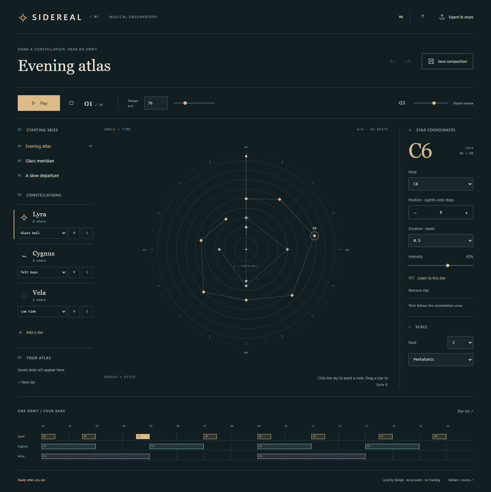
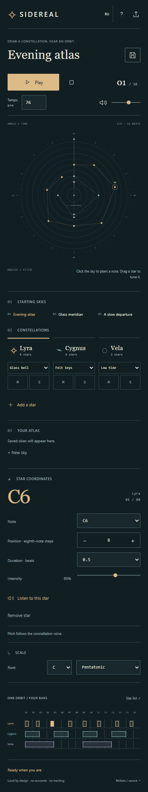

# SIDEREAL

**Draw a constellation. Hear an orbit.**

A small musical observatory by **Beibars / [seoshiro](https://github.com/seoshiro)**. Plant notes in a circular sky and let a clockwise cursor play them as a four-bar composition. A precise sequencer with the quiet, graphic character of an astronomical atlas.

**[Open the instrument](https://seoshiro.github.io/sidereal/)** · [Verification notes](docs/QA.md) · [MIT license](LICENSE)



## Make a sky

1. Choose **Evening atlas**, **Glass meridian**, or **A slow departure**, or start a new empty sky.
2. Select a constellation: **Lyra**, **Cygnus**, or **Vela**. Each has an independent synthesized voice and mute/solo controls.
3. Click the sky to plant a note. Clockwise changes its time; outward changes its pitch. Notes are quantized to the selected scale.
4. Edit the exact note, eighth-note step, duration, intensity, root, scale, voice, and tempo. Press **Play** when ready.
5. Save a named composition to the local atlas, or export a file.

There are 32 eighth-note positions in a 16-beat orbit, 15 available scale degrees per voice, 3 constellations, and a limit of 96 stars. The scale can be pentatonic, natural minor, Dorian, or major; tempo ranges from 40 to 180 BPM. Duration can be a quarter, half, one, two, or four beats. Bell, felt, and tide voices have different envelopes and octave ranges.

## Keep and share your work

- The current sky restores automatically on the same device. The atlas stores up to 24 named compositions. Saving an existing composition updates its atlas entry.
- **Score JSON** is a portable, validated SIDEREAL v1 file. Import rejects invalid versions, ranges, duplicated or unsafe IDs, files over 60 KB, and more than 96 notes. Unknown fields are stripped.
- **Share links** carry the score in the URL fragment, with a 12,000-character limit. The app does not upload the score to a server. Anyone who has the link can read it; this is not encryption or access control. Large scores should be shared as files. Opening a link never starts sound, and the link is consumed so subsequent reloads restore your edits.
- **PNG** exports a 1600 × 1880 visual score with its title, tuning, tempo, and voices.
- **WAV** renders one orbit at 44.1 kHz, stereo, 16-bit PCM, including the final release tails. It respects layer mute/solo and the master volume. Master mute controls listening; it does not silently blank a WAV export.

Browser storage is local, not a backup. Clearing browser data removes the atlas. Export a JSON file for work you want to keep.

## Keyboard, touch, and accessibility

- **Space** plays or pauses outside form controls; **Escape** stops sound.
- Focus a star and use **Left / Right** for time and **Up / Down** for pitch. **Enter** opens its exact controls; **Delete** removes it.
- **Ctrl/Cmd + Z** undoes; **Ctrl/Cmd + Shift + Z** redoes. The history holds 60 edits and resets on reload.
- **Add a star**, the inspector, the linear score, and the **Star list** provide alternatives to dragging the SVG.
- Native buttons, selects, inputs, dialogs, visible focus, accessible names, live status messages, and one RU/EN translation table are used throughout.
- On phones, the transport remains available while scrolling. Empty areas of the sky allow vertical touch scrolling. Reduced motion disables the sweep and note pulses while preserving sound and the beat readout.



## Run locally

Node.js 22.12+ or 24 and npm are needed for development. The published instrument has no runtime dependencies or server.

```sh
npm ci --ignore-scripts
npm run dev
npm test
npm run build
```

For browser verification:

```sh
npx playwright install chromium
npm run dev
npm run qa
node scripts/edge-qa.mjs
node scripts/capture.mjs
```

Set `QA_URL` to a built preview or published URL. Set `QA_BROWSER` to an existing Chromium executable when needed. QA launches a separate temporary browser; it never attaches to a personal browser profile. Outputs go to ignored `qa-artifacts/`. Screenshot capture writes `docs/screenshots/`.

## Architecture

| File                 | Responsibility                                                                                            |
| -------------------- | --------------------------------------------------------------------------------------------------------- |
| `src/model.ts`       | Versioned score model, deterministic presets, scale mapping, geometry, validation, URL serialization      |
| `src/audio.ts`       | Web Audio voices, bounded scheduler, amplitude budget, compressor, offline render, PCM WAV encoder        |
| `src/main.ts`        | Instrument UI, selection and drag, keyboard editing, local atlas, undo/redo, file handling and PNG export |
| `src/i18n.ts`        | One keyed RU/EN translation table                                                                         |
| `src/style.css`      | Custom observatory design and responsive/reduced-motion layouts                                           |
| `tests/core.test.ts` | Model, geometry, scale and untrusted-input checks                                                         |
| `scripts/*qa.mjs`    | Browser interaction, audio decode, responsive and lifecycle checks                                        |

The audio context is created only after Play or Listen. The scheduler runs every 25 ms with a 100 ms scheduling horizon. Oscillators have finite stop times and disconnect when complete. Pause, Stop, and layer edits clear outstanding voices. The amplitude budget accounts for overlapping note tails and reserves room for a preview voice; a compressor smooths transients. A hidden tab pauses playback and requires an explicit restart.

No samples, commercial recordings, external fonts, analytics, network APIs, keys, accounts, billing, or paid services are used. GitHub Pages serves the built static assets. Vite uses a relative base, so `/sidereal/` works. The Actions workflow tests and builds the source before deploying.

## Honest limits

- This is a fixed four-bar, three-voice instrument. It does not record microphone audio, import MIDI, or synchronize devices.
- Browser audio and storage availability differ, especially in private browsing and mobile browsers. If Web Audio is unavailable, visual editing remains usable and Play reports an error.
- Background playback is deliberately paused. On phones, use the exact controls or Star list when close stars are awkward to touch.
- PNG is a visual constellation score, not standard staff notation. WAV exports one pass with its release tails, not an infinitely looping file.
- Automated QA verified real Web Audio rendering and decode. It is **not a human listening review**. Real iOS/Safari and physical-device listening are still recommended.

See [QA evidence and visual audit](docs/QA.md) for tested versions, scenarios, and remaining verification limits.
